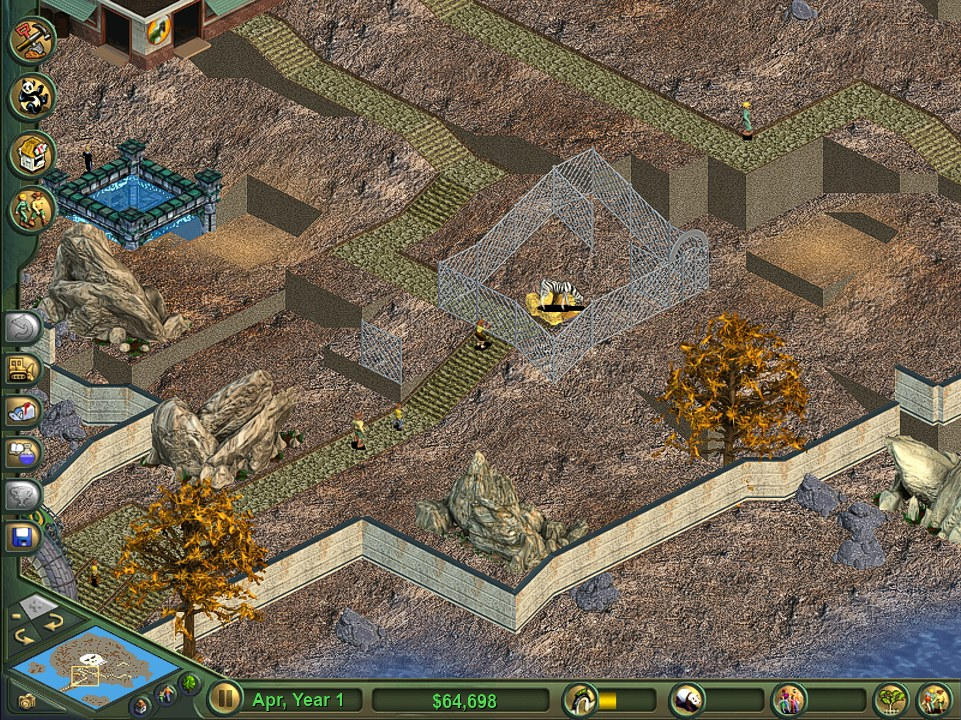
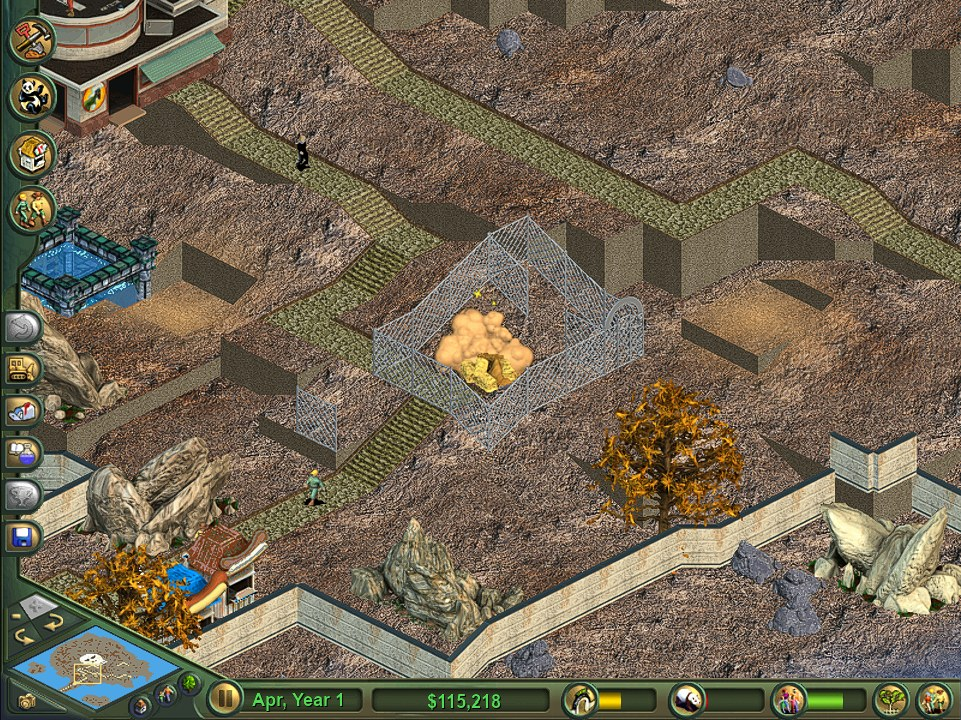
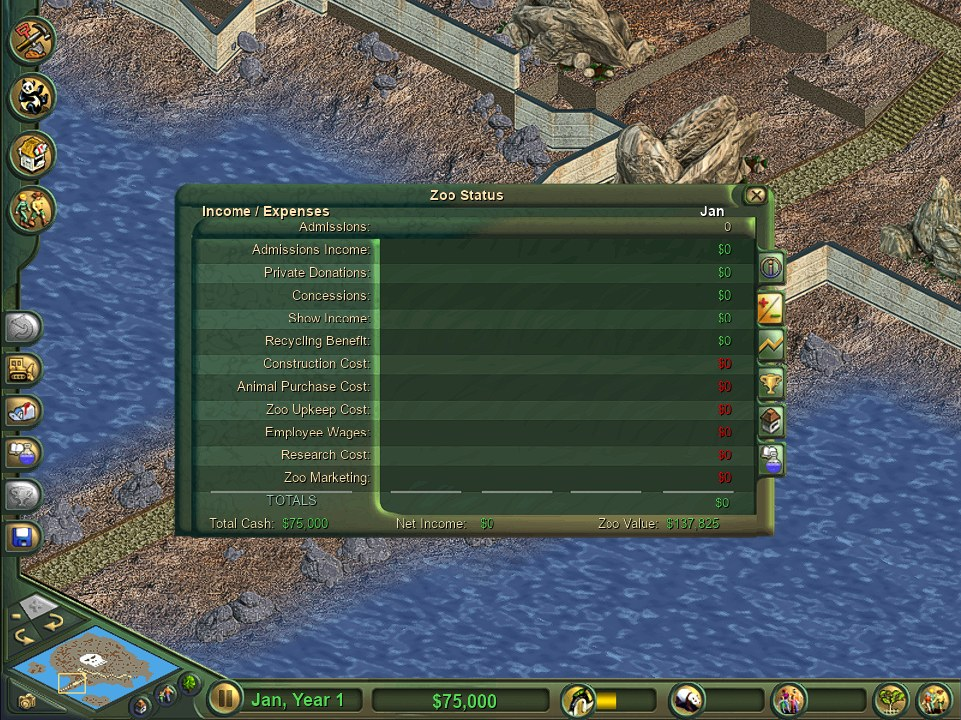
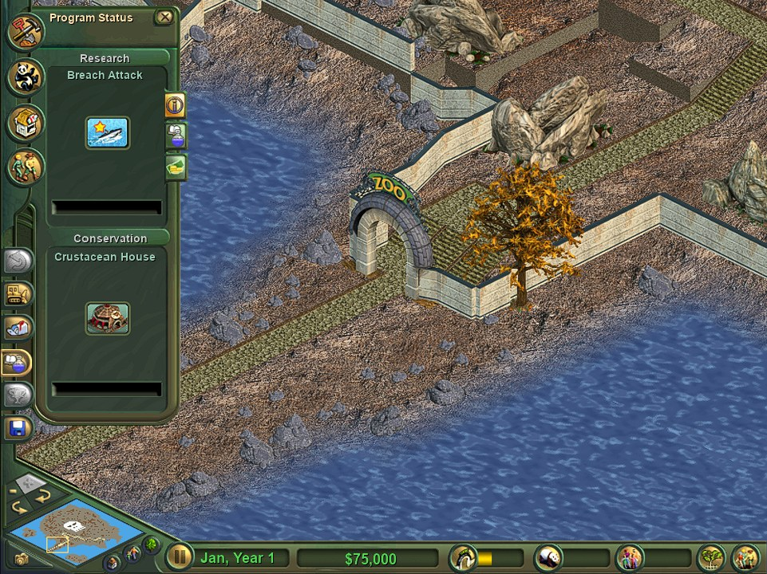

# ZT1-Engine

**An open-source engine for Zoo Tycoon 1 on modern Windows: the original game, rebuilt to 2026 standards, for everyone to play, mod and improve.**

Think of it as OpenRCT2 for Zoo Tycoon. The original game is the spec. Every rule (animal happiness, guest needs, the zoo rating, prices, research, escapes, predators) is recovered from the original `zoo.exe` and checked against it, not guessed. The game plays as it always did, only on today's PCs, at any window size, with bugs fixed and with optional extras you can switch on.

You need your own copy of Zoo Tycoon. The engine ships **none** of the game's art, sound or files: it imports them from your install the first time it runs.

> **Status: alpha.** The base game's freeform mode is playable and being polished against the original. A new alpha comes out **every week**. Expect rough edges, back up saves you care about, and please report anything that behaves differently from the original.

---

## Why this exists

Zoo Tycoon 1's engine has no documentation, no source, no support from Microsoft and almost nobody left who knows how it works. It was built to run one game, in 2001, and it shows its age on modern Windows.

This project rebuilds that engine in the open so the game can live on. The goals are:

1. **Faithful.** It does what the original does, measured against the original running side by side. Changing the original game is not the point.
2. **Better on today's PCs.** Any resolution, a scaled UI, sharper drawing, fixes for old crashes and bugs.
3. **Optional extras, never forced.** Everything beyond the original is a switch, and switched off you get the original's behaviour exactly.
4. **Open to everyone.** The engine, the tools and the knowledge about the original are here for anyone to use, learn from, fork and build on. The aim is that nothing about how Zoo Tycoon works stays secret sauce.
5. **Friendly to new programmers and modders.** Clear code, notes on where every rule came from, and tools that make reverse engineering and modding approachable for people who've never done it.

This is made out of love for the game. It isn't affiliated with Microsoft or Blue Fang Games.

---

## Getting it

| Where | What |
|---|---|
| **[GitHub Releases](https://github.com/AlexC1991/zt1-engine/releases)** | Every weekly alpha, with release notes |
| **CodeRook** | The same builds |

Both places get the same build each week. Unzip it anywhere you can write to (not `Program Files`), run **`start.bat`**, and on first run point it at your Zoo Tycoon folder if it isn't found by itself. The download has its own README with the full steps.

### What you need

- Windows 10 or 11, 64-bit
- Zoo Tycoon 1. The **base game** is enough; the Complete Collection works too.
- Python 3, for `start.bat`'s first-run import (being moved into the engine, so this requirement will go away)

**Linux / macOS:** this project is Windows only. For Linux, see [sharkwouter's zt1-engine](https://github.com/sharkwouter/zt1-engine), which this project grew from.

---

## What works now

The base game's **freeform** mode is the focus, and most of it works as in the original:

- **Menus and screens:** loading screen, main menu, freeform and scenario selection, credits, the in-game HUD and panels, tooltips, messages.
- **Saving and loading:** the original's save and load dialogs, Continue Saved Game. (Saves use our own format; reading the original's `.zoo` saves comes later.)
- **Building:** terraforming, paths, every fence type and gate, exhibits, scenery, foliage, rocks, buildings and shops, shelters and toys; the bulldozer and undo.
- **Animals:** adopting and selling, the original's behaviours and animations, eating, drinking, sleeping, swimming, exhibit suitability and happiness worked out as `zoo.exe` does, breeding, illness, old age.
- **Escapes and predators:** jumpers jump, climbers climb, bashers break fences. Loose meat-eaters chase guests and keepers dart and crate them. Predators hunt their prey in exhibits.
- **Guests:** arriving by the zoo's rating, needs, shops, tours, donations, thoughts, litter, fleeing.
- **Staff:** zookeepers, maintenance workers and tour guides, with hiring, firing and duties.
- **The zoo's business:** zoo rating, admissions, marketing, finances, graphs, research and conservation, freeform goals and awards.
- **Sound:** music, ambience, crowds, guests, animals and buildings.

Marine Mania tanks are partly in. Marine Mania and Dinosaur Digs come after the base game is done.

| | |
|---|---|
|  |  |
| Guests, keepers and the zoo at work | Predators hunt the prey they list |
|  |  |
| The original's panels: Zoo Status, finances, graphs | Research and conservation |

### Optional extras

Each is a switch; off means the original's behaviour. Flip them in the in-game dev console (`features`, `set <name> on|off`); an options menu for them is planned.

| Switch | What it does |
|---|---|
| `allUnlocked` | every item available in freeform from day one |
| `fenceModes` / `pathModes` | fence and path drags that can bend; Tab cycles the shape |
| `elevatedPaths` | raised walkways and stairs, from the original's path art |
| `staffPaths` / `smoothRoutes` | staff keep to paths; walkers take straighter routes |
| `mapTooltips` | hints over the map, not only on buttons |
| `hotkeys` | Esc / right-click put tools away, Ctrl+Z undoes, Q/E rotate |
| `mods` | load mods from the `mods` folder |

---

## Modding

Mods use the game's own kind of files. A mod is a folder in `mods/` with a `mod.json` (`name`, `author`, `version`, `about`, `replaces`) and `.ztd` archives holding files under their game paths. They take the place of the originals while switched on, the same way the original game's own patches work. The in-game mod menu turns them on and off.

More modding is coming: documented formats, small engine scripts (`src/scripts/` has examples), and guides written for people who are new to it.

---

## Tools for contributors: the ZT1 Lab, and AI agents

**The ZT1 Lab** (`lab-app/`) is the workbench this engine is built with, and it's yours to use too. It's a desktop app that puts everything in one place:
- the original's code, through Ghidra;
- the game's files;
- our engine's code, with a build button;
- a test zoo where you can step through the engine's logic live;
- the original game running alongside, for recording what it does.

Its **Explore** view answers "where is X in the original, and do we have it yet?". See [lab-app/README.md](lab-app/README.md).

**Use it with your own AI agent.** The Lab comes with an [MCP](https://modelcontextprotocol.io) server (`lab-app/mcp/server.js`), so any agent that speaks MCP can drive the Lab: Claude Code, Codex, Cursor, VS Code / Copilot, Gemini CLI, and others. That covers searching the original's functions, reading their code, editing and building the engine, placing things in the test zoo and reading what happened.
- It runs on your own PC only (it talks to the Lab on 127.0.0.1).
- Everything it does happens visibly in the Lab's window.

Claude Code picks it up from this repo's `.mcp.json` by itself. Other agents need one entry in their MCP settings:

```json
{ "mcpServers": { "zt1-lab": { "command": "node", "args": ["lab-app/mcp/server.js"] } } }
```

(Use the full path to `server.js` if your agent doesn't start in the repo's folder.) Start the Lab first, with `lab-app/ZT1 Lab.cmd`.

Using an agent is entirely optional. Everything it can do, you can do by hand in the Lab.

---

## Contributing

**Everyone is welcome:** players reporting bugs, modders, and programmers of any level. See **[CONTRIBUTING.md](CONTRIBUTING.md)** for how to build, how the code is laid out, and the one big rule: *the original game is the spec*.

The most useful thing anyone can do is report a difference from the original: what you did, what the original does, what the engine does, with screenshots or a saved zoo.

You're also free to fork it and take it your own way. That's what open source is for.

---

## Roadmap

1. **Base Zoo Tycoon freeform, one to one with the original.** Every system checked against `zoo.exe`, function by function.
2. **An options menu** for the extras, and a friendlier mod menu.
3. **Scenarios:** every scenario's goals and events.
4. **Marine Mania**, then **Dinosaur Digs**.
5. **The original's `.zoo` saves:** loading them.

---

## How it's made (and AI)

The original's rules are recovered by reading `zoo.exe`'s machine code (in Ghidra) and by watching the original run side by side with this engine. That's slow, detailed work. AI tools are part of the toolset alongside Ghidra and the ZT1 Lab, above all for reading and decoding the original binary, and as a coding assistant.

- **There's no AI-generated content in the game.** No AI art, audio or text: everything you see and hear comes from your own copy of Zoo Tycoon.
- **Every rule is traceable.** The code comments cite the address in `zoo.exe` each rule was copied from, or say it was measured from the original, or mark it as our own. Anyone can check the work.

For a one-person project, that's what makes an engine like this possible. You're free to contribute with whatever tools you like, or to fork and do it your way.

---

## Credits

- **[Wouter (sharkwouter) Wijsman](https://github.com/sharkwouter)** started zt1-engine. This project grew from his work, and he continues the Linux side in [his repository](https://github.com/sharkwouter/zt1-engine).
- **batty251** (AlexC1991 on GitHub): the Windows engine, reverse engineering and maintenance.
- **Everyone who contributes, tests and reports bugs.**
- Zoo Tycoon was made by Blue Fang Games and published by Microsoft. This project isn't affiliated with either.

The icon is from [a picture by Magda Ehlers on Pexels](https://www.pexels.com/photo/zebra-s-eye-760958/).

## License

MIT: see [LICENSE.txt](LICENSE.txt). Third-party libraries (SDL2, SDL2_image, SDL2_mixer, SDL2_ttf, FreeType, pe-resource-loader, libzip, zlib) keep their own licenses: see [THIRD_PARTY_LICENSES.md](THIRD_PARTY_LICENSES.md).
