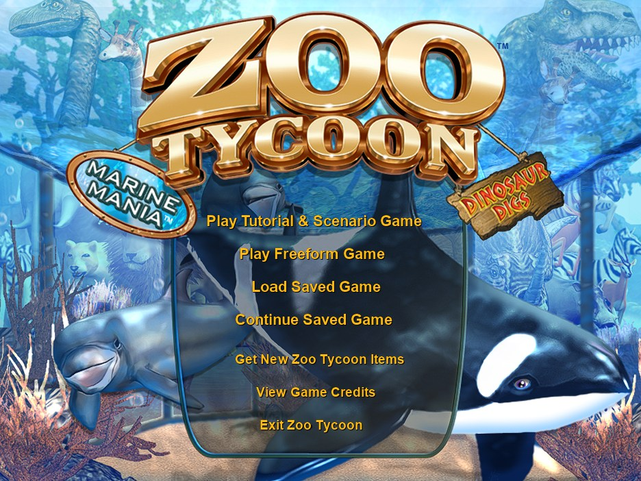

<div align="center">

<pre>
            _____________ __&nbsp;&nbsp;&nbsp;&nbsp;&nbsp;&nbsp;&nbsp;&nbsp;&nbsp;&nbsp;&nbsp;&nbsp;
           |___  /__   __/_ |&nbsp;&nbsp;&nbsp;&nbsp;&nbsp;&nbsp;&nbsp;&nbsp;&nbsp;&nbsp;&nbsp;
              / /   | |   | |&nbsp;&nbsp;&nbsp;&nbsp;&nbsp;&nbsp;&nbsp;&nbsp;&nbsp;&nbsp;&nbsp;
             / /    | |   | |&nbsp;&nbsp;&nbsp;&nbsp;&nbsp;&nbsp;&nbsp;&nbsp;&nbsp;&nbsp;&nbsp;
            / /__   | |   | |&nbsp;&nbsp;&nbsp;&nbsp;&nbsp;&nbsp;&nbsp;&nbsp;&nbsp;&nbsp;&nbsp;
           /_____|  |_|   |_|&nbsp;&nbsp;&nbsp;&nbsp;&nbsp;&nbsp;&nbsp;&nbsp;&nbsp;&nbsp;&nbsp;
&nbsp;&nbsp;&nbsp;&nbsp;&nbsp;&nbsp;&nbsp;&nbsp;&nbsp;&nbsp;&nbsp;&nbsp;&nbsp;&nbsp;&nbsp;&nbsp;&nbsp;&nbsp;&nbsp;&nbsp;&nbsp;&nbsp;&nbsp;&nbsp;&nbsp;&nbsp;&nbsp;&nbsp;&nbsp;&nbsp;&nbsp;&nbsp;&nbsp;&nbsp;&nbsp;&nbsp;&nbsp;&nbsp;&nbsp;&nbsp;
 ______ _   _  _____ _____ _   _ ______&nbsp;
|  ____| \ | |/ ____|_   _| \ | |  ____|
| |__  |  \| | |  __  | | |  \| | |__&nbsp;&nbsp;&nbsp;
|  __| | . ` | | |_ | | | | . ` |  __|&nbsp;&nbsp;
| |____| |\  | |__| |_| |_| |\  | |____&nbsp;
|______|_| \_|\_____|_____|_| \_|______|
</pre>

**An open-source engine for Zoo Tycoon 1 on modern Windows: the original game, rebuilt to 2026 standards, for everyone to play, mod and improve.**

<a href="https://github.com/AlexC1991/zt1-engine/releases"></a>   <a href="LICENSE.txt"></a>

<a href="#getting-it">Get it</a> &nbsp;&middot;&nbsp; <a href="#what-works-now">What works</a> &nbsp;&middot;&nbsp; <a href="#modding">Modding</a> &nbsp;&middot;&nbsp; <a href="#contributing">Contribute</a> &nbsp;&middot;&nbsp; <a href="#roadmap">Roadmap</a> &nbsp;&middot;&nbsp; <a href="#q--a">Q &amp; A</a> &nbsp;&middot;&nbsp; <a href="#community-forks--related-projects">Forks</a>

<br>



<sub>The ZT1-Engine main menu, drawn from your own copy of Zoo Tycoon.</sub>

</div>

Think of it as OpenRCT2 for Zoo Tycoon. The original game is the spec. Every rule (animal happiness, guest needs, the zoo rating, prices, research, escapes, predators) is recovered from the original `zoo.exe` and checked against it, not guessed. The game plays as it always did, only on today's PCs, at any window size, with bugs fixed and with optional extras you can switch on.

> [!NOTE]
> You need your own copy of Zoo Tycoon. The engine ships **none** of the game's art, sound or files: it imports them from your install the first time it runs.

> [!IMPORTANT]
> **Status: alpha.** The base game's freeform mode is playable and being polished against the original. A new alpha comes out **every week**. Expect rough edges, back up saves you care about, and please report anything that behaves differently from the original.

---

## Why this exists

Zoo Tycoon 1's engine has no documentation, no source, no support from Microsoft and almost nobody left who knows how it works. It was built to run one game, in 2001, and it shows its age on modern Windows.

This project rebuilds that engine in the open so the game can live on. The goals are:

1. **Faithful.** It does what the original does, measured against the original running side by side. Changing the original game is not the point.
2. **Better on today's PCs.** Any resolution, a scaled UI, sharper drawing, fixes for old crashes and bugs.
3. **Optional extras, never forced.** Everything beyond the original is a switch, and switched off you get the original's behaviour exactly.
4. **Open to everyone.** The engine, the tools and the knowledge about the original are here for anyone to use, learn from, fork and build on. The aim is that nothing about how Zoo Tycoon works stays secret sauce.
5. **Friendly to new programmers and modders.** Clear code, notes on where every rule came from, and tools that make reverse engineering and modding approachable for people who've never done it.

This is made out of love for the game. It isn't affiliated with Microsoft or Blue Fang Games.

---

## Getting it

| Where | What |
|---|---|
| **[GitHub Releases](https://github.com/AlexC1991/zt1-engine/releases)** | Every weekly alpha, with release notes |
| **CodeRook** | The same builds |

Both places get the same three files each week. **Two of them play the game; the third is for looking inside it.**

| Download | What it is |
|---|---|
| **`ZT1-Engine-Setup-<version>.exe`** — 4 MB | **The engine. Get this one.** An installer, no admin prompt. Start ZT1-Engine and it finds your Zoo Tycoon by itself (or asks you once where it is), reads the game where it's installed without ever changing your game's folder, and offers each new alpha at the main menu. |
| **`ZT1-Game-Build-<version>-win64.zip`** — 3 MB | **The other way to play.** A folder that runs on its own, like the first alpha: unzip it anywhere and run `start.bat`. The first time it copies your Zoo Tycoon's files in beside the engine, and for that it needs [Python 3](https://www.python.org/downloads/) installed. After that the folder plays by itself, but it doesn't update itself — download the next one when it's out. |
| **`ZT1-Lab-Setup-<version>.exe`** — 570 MB | **Not needed to play.** The workbench the engine is developed with: it reads your own `zoo.exe`, shows what each address in it does, records which code runs in which situation, and edits and builds this engine's C++ beside it. |

Every download has its **`.sha256`** beside it, so you can check what you got.

### The ZT1 Lab, if you want it

The Lab is for anyone who wants to know how Zoo Tycoon and this engine actually
work. **Playing does not need it, and it is a 570 MB download** — skip it unless
that sentence describes you.

It installs the same way, for you alone with no admin prompt, and **everything
it needs is inside it**: the decompiler (Ghidra) and the Java it runs on, an
embeddable Python with the packages its tools use, and its knowledge base. There
is nothing to install first. Like the engine, it ships **none** of the game's
files — it reads your own copy where it is.

You can point it at the engine's source to edit and build, or let it use what it
carries. How it works: [`lab-app/README.md`](lab-app/README.md).

Each download's own README has the rest.

### What you need

- Windows 10 or 11, 64-bit
- Zoo Tycoon 1. The **base game** is enough; the Complete Collection works too.

**Linux / macOS:** this repository focuses on the Windows build (see the [Q & A](#q--a) and [Forks & Related Projects](#community-forks--related-projects) below). For Linux or cross-platform work, see [sharkwouter's zt1-engine](https://github.com/sharkwouter/zt1-engine), its [`openztc` branch](https://github.com/sharkwouter/zt1-engine/tree/openztc), or any of the community forks listed below.

---

## What works now

The base game's **freeform** mode is the focus, and most of it works as in the original:

- **Menus and screens:** loading screen, main menu, freeform and scenario selection, credits, the in-game HUD and panels, tooltips, messages.
- **Saving and loading:** the original's save and load dialogs, Continue Saved Game. (Saves use our own format; reading the original's `.zoo` saves comes later.)
- **Building:** terraforming, paths, every fence type and gate, exhibits, scenery, foliage, rocks, buildings and shops, shelters and toys; the bulldozer and undo.
- **Animals:** adopting and selling, the original's behaviours and animations, eating, drinking, sleeping, swimming, exhibit suitability and happiness worked out as `zoo.exe` does, breeding, illness, old age.
- **Escapes and predators:** jumpers jump, climbers climb, bashers break fences. Loose meat-eaters chase guests and keepers dart and crate them. Predators hunt their prey in exhibits.
- **Guests:** arriving by the zoo's rating, needs, shops, tours, donations, thoughts, litter, fleeing.
- **Staff:** zookeepers, maintenance workers and tour guides, with hiring, firing and duties.
- **The zoo's business:** zoo rating, admissions, marketing, finances, graphs, research and conservation, freeform goals and awards.
- **Sound:** music, ambience, crowds, guests, animals and buildings.

Marine Mania tanks are partly in. Marine Mania and Dinosaur Digs come after the base game is done.

| | |
|---|---|
|  |  |
| Guests, keepers and the zoo at work | Predators hunt the prey they list |
|  |  |
| The original's panels: Zoo Status, finances, graphs | Research and conservation |

### Optional extras

Each is a switch; off means the original's behaviour. Flip them in the in-game dev console (`features`, `set <name> on|off`); an options menu for them is planned.

| Switch | What it does |
|---|---|
| `allUnlocked` | every item available in freeform from day one |
| `fenceModes` / `pathModes` | fence and path drags that can bend; Tab cycles the shape |
| `elevatedPaths` | raised walkways and stairs, from the original's path art |
| `staffPaths` / `smoothRoutes` | staff keep to paths; walkers take straighter routes |
| `mapTooltips` | hints over the map, not only on buttons |
| `hotkeys` | Esc / right-click put tools away, Ctrl+Z undoes, Q/E rotate |
| `mods` | load mods from the `mods` folder |

---

## Modding

Mods use the game's own kind of files. A mod is a folder in `mods/` with a `mod.json` (`name`, `author`, `version`, `about`, `replaces`) and `.ztd` archives holding files under their game paths. They take the place of the originals while switched on, the same way the original game's own patches work. The in-game mod menu turns them on and off.

More modding is coming: documented formats, small engine scripts (`src/scripts/` has examples), and guides written for people who are new to it.

---

## Tools for contributors: the ZT1 Lab, and AI agents

**The ZT1 Lab** (`lab-app/`) is the workbench this engine is built with, and it's yours to use too. It's a desktop app that puts everything in one place:
- the original's code, through Ghidra;
- the game's files;
- our engine's code, with a build button;
- a test zoo where you can step through the engine's logic live;
- the original game running alongside, for recording what it does.

Its **Explore** view answers "where is X in the original, and do we have it yet?". See [lab-app/README.md](lab-app/README.md).

**Use it with your own AI agent.** The Lab comes with an [MCP](https://modelcontextprotocol.io) server (`lab-app/mcp/server.js`), so any agent that speaks MCP can drive the Lab: Claude Code, Codex, Cursor, VS Code / Copilot, Gemini CLI, and others. That covers searching the original's functions, reading their code, editing and building the engine, placing things in the test zoo and reading what happened.
- It runs on your own PC only (it talks to the Lab on 127.0.0.1).
- Everything it does happens visibly in the Lab's window.

Claude Code picks it up from this repo's `.mcp.json` by itself. Other agents need one entry in their MCP settings:

```json
{ "mcpServers": { "zt1-lab": { "command": "node", "args": ["lab-app/mcp/server.js"] } } }
```

(Use the full path to `server.js` if your agent doesn't start in the repo's folder.) Start the Lab first, with `lab-app/ZT1 Lab.cmd`.

Using an agent is entirely optional. Everything it can do, you can do by hand in the Lab.

---

## Contributing

**Everyone is welcome:** players reporting bugs, modders, and programmers of any level. See **[CONTRIBUTING.md](CONTRIBUTING.md)** for how to build, how the code is laid out, and the one big rule: *the original game is the spec*.

The most useful thing anyone can do is report a difference from the original: what you did, what the original does, what the engine does, with screenshots or a saved zoo.

You're also free to fork it and take it your own way. That's what open source is for.

---

## Roadmap

1. **Base Zoo Tycoon freeform, one to one with the original.** Every system checked against `zoo.exe`, function by function.
2. **An options menu** for the extras, and a friendlier mod menu.
3. **Scenarios:** every scenario's goals and events.
4. **Marine Mania**, then **Dinosaur Digs**.
5. **The original's `.zoo` saves:** loading them.

---

## How it's made (and AI)

The original's rules are recovered by reading `zoo.exe`'s machine code (in Ghidra) and by watching the original run side by side with this engine. That's slow, detailed work. AI tools are part of the toolset alongside Ghidra and the ZT1 Lab, above all for reading and decoding the original binary, and as a coding assistant.

- **There's no AI-generated content in the game.** No AI art, audio or text: everything you see and hear comes from your own copy of Zoo Tycoon.
- **Every rule is traceable.** The code comments cite the address in `zoo.exe` each rule was copied from, or say it was measured from the original, or mark it as our own. Anyone can check the work.

For a one-person project, that's what makes an engine like this possible. You're free to contribute with whatever tools you like, or to fork and do it your way.

---

## Q & A

### Playing

**Do I need to own Zoo Tycoon?**
Yes. The engine ships none of the game's art, sound or files. It reads them from your own installed copy, the first time it runs.

**Is the base game enough, or do I need the Complete Collection?**
The base game is enough. The Complete Collection works too. Marine Mania and Dinosaur Digs content isn't playable yet.

**Which download do I want?**
Almost everyone wants `ZT1-Engine-Setup`. It's small, needs no admin rights, finds your game by itself and offers each new alpha at the main menu. `ZT1-Game-Build` is the same game as a folder you unzip and run with `start.bat`. It needs Python 3 the first time and doesn't update itself. `ZT1-Lab-Setup` is 570 MB and is only for people who want to look inside `zoo.exe`. You don't need it to play.

**Will it change my Zoo Tycoon install?**
No. The installer version reads your game where it is and never writes to that folder.

**Can I load my old saves, or play scenarios?**
Not yet. Saves from this engine use their own format. Scenarios and loading the original's `.zoo` saves are on the roadmap, after the base game's freeform mode matches the original.

**Something behaves differently from the original. Where do I report it?**
Open an issue. Say what you did, what the original does and what the engine does. A screenshot or a saved zoo helps a lot. These reports are the most useful thing anyone can send me.

---

### Linux, macOS, forks and pull requests

**Is there a Linux or macOS version?**
Not from me. I'm putting all my effort into the Windows build until it's fully built out, and I have no plans for a Linux or macOS one. Other people are working on those, and they're listed in [Community Forks & Related Projects](#community-forks--related-projects) below.

**Do you accept pull requests?**
Yes, for things like bug fixes, accuracy fixes where you can point to `zoo.exe` or a measurement, formula checks and docs. Please keep each one small and focused.

**Then why won't you merge a Linux or macOS port, or another big piece of work?**
It's not a question of quality. If I merge a big piece of work and the person who wrote it later moves on, I'm left maintaining code I didn't write and often can't test. That's too much for a one-person project. So for anything large, please fork the repo and keep it as your own project. You stay in charge of it and nothing depends on me.

**What happens if I fork it?**
That's welcome, and the MIT license allows it. If you tell me about your fork, I'll add it to the list below and send people your way. It doesn't matter what system it runs on or how many forks there end up being. If there are five Mac builds, I'll list all five.

**Is there a Discord or chat server?**
No. I don't want to host or moderate one, because then the project would depend on me being around to run it. Everything happens in the open here, in issues and pull requests.

---

### Reverse engineering and modding

**How do I share what I find in `zoo.exe`? Do I have to use the ZT1 Lab?**
No. You can stay in Ghidra and your own workflow. The shared knowledge base is a plain web service. You pull from it and send to it over HTTPS, with no account and no token. The ZT1 Lab can do it for you through its MCP tool, but nothing requires the Lab. If you'd rather not touch it, open an issue with what you found and I'll add it. The details are in [`re/cloud/README.md`](re/cloud/README.md).

**Why does the knowledge base care which `zoo.exe` I have?**
Every finding in it is an address, and an address is only true of one exact file. The base is for one build of `zoo.exe`: 2,449,432 bytes, SHA-256 starting `61fcc6d1`. It refuses contributions from any other file, because the addresses would land on the wrong functions and spoil it for everyone. Check your own file's size and hash first. If they match, your findings can go straight in.

**I have findings from a different build, such as the Mac version. Are they useless?**
No. Addresses from another build can't go in as they are, but class and struct names are stored by name, not by address. Those can be matched up to this build and are very welcome. Open an issue and tell me what you have.

**Can I trust what's in the knowledge base?**
Treat it as checked work, not as gospel. A new finding stays provisional until I've reviewed it. Observations of what ran in which situation are published straight away and marked unverified. Every rule in the engine cites the address or measurement it came from, so you can check it yourself.

**Can I make mods?**
Yes. A mod is a folder in `mods/` with a `mod.json` and `.ztd` archives that replace the originals while it's switched on, the same way the game's own patches work. There's more in the Modding section above.

---

### The project

**Is AI used to make the game?**
Nothing in the game is AI-generated: no art, audio or text. Everything you see and hear comes from your own copy of Zoo Tycoon. AI tools are part of how the engine is built, mainly for reading and decoding `zoo.exe` alongside Ghidra, and as a coding assistant. Every rule still cites where it came from, so the work can be checked. You're free to use whatever tools you like when you contribute.

**Is this affiliated with Microsoft or Blue Fang?**
No. It's a hobby project made out of love for the game.

---

## Community Forks & Related Projects

Building your own fork, or something related to Zoo Tycoon, on any system? Open an issue with a link and a line about what it is, and I'll add it here.

| Project | System | What it is |
|---|---|---|
| [sharkwouter/zt1-engine](https://github.com/sharkwouter/zt1-engine) | Linux | The original zt1-engine by Wouter Wijsman, which this project grew from |
| [sharkwouter/zt1-engine, `openztc` branch](https://github.com/sharkwouter/zt1-engine/tree/openztc) | Cross-platform | A separate cross-platform line, developed independently |
| [StevenGann/zt1-engine, `linux-port`](https://github.com/StevenGann/zt1-engine/tree/linux-port) | Linux | A Linux port of this engine |

---

## Credits

- **[Wouter (sharkwouter) Wijsman](https://github.com/sharkwouter)** started zt1-engine. This project grew from his work, and he continues the Linux side in [his repository](https://github.com/sharkwouter/zt1-engine).
- **batty251** (AlexC1991 on GitHub): the Windows engine, reverse engineering and maintenance.
- **Everyone who contributes, tests and reports bugs.**
- Zoo Tycoon was made by Blue Fang Games and published by Microsoft. This project isn't affiliated with either.

The icon is from [a picture by Magda Ehlers on Pexels](https://www.pexels.com/photo/zebra-s-eye-760958/).

## License

MIT: see [LICENSE.txt](LICENSE.txt). Third-party libraries (SDL2, SDL2_image, SDL2_mixer, SDL2_ttf, FreeType, pe-resource-loader, libzip, zlib) keep their own licenses: see [THIRD_PARTY_LICENSES.md](THIRD_PARTY_LICENSES.md).
