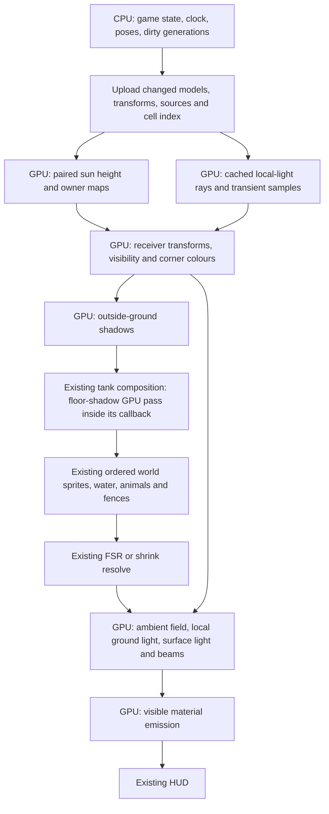

# GPU lighting implementation map

5 November 2026. **Experimental GPU passes are available for comparison.**

`ZT_LIGHTING_GPU=ground` enables GPU ground and tank-floor receivers with CPU
sun maps. `ZT_LIGHTING_GPU=1` also enables GPU surface colour and clipping.
`ZT_LIGHTING_GPU=atlas` adds GPU sun-map construction. Ordinary game launches
use the reference backend while the experimental passes are being verified.
`ZT_LIGHTING_BENCH=gpu` with the existing `--panel-shots` mode runs the paired
renderer checks. Local-light rays, beam preparation and emission visibility
still run on the CPU.

The atlas prototype uses the compute route described below. It separates
height selection from the owner tie-break and follows the original scanline
arithmetic. Both shadow samples remain in GPU buffers for the receiver passes.

The 1280 by 720 marine fixture confirmed both tanks and 36 comparisons
across four rotations, three zoom levels and noon, sunset and night. The
generated atlases produced the same rendered images as the uploaded CPU
atlases in all 36 cases. The combined path stayed within two colour levels
of the CPU reference after preserving native sprite mask UV rounding. The
test also confirmed that switching day/night off restores the daylight image
exactly. Results are local to this renderer and fixture.

An initial 18-second 1× run on the RX 6600 used the populated benchmark zoo and
native art. It measured 15.39 FPS on the CPU reference, 13.94 FPS on the
ground-only bridge and 15.51 FPS with GPU atlases and receivers. The combined
path's 95th-percentile frame time was 71.02 ms versus 78.89 ms for the CPU
reference. These are single short measurements. They are insufficient to
establish a sustained frame-rate improvement or replace the full benchmark
matrix.

The instrumented follow-up found where the savings went. Average CPU-side
elapsed time for the sun scope fell from 2.70 to 0.37 ms, and surface
preparation fell from 5.22 to 2.41 ms. Tank composition rose from 20.56 to
26.23 ms. These scopes include driver time and can overlap. The ground pass
now reuses matching index buffers across frames. In the repeated 18-second
run, average FPS was 15.87 CPU and 15.59 GPU, while 95th-percentile frame time
was 72.69 ms CPU and 66.40 ms GPU. The remaining work includes profiling tank
synchronization and keeping surface inputs resident.

The existing lighting and animated-shadow suites passed 70 checks with the
GPU atlas backend. The comparison receipts and benchmark files are under
`E:/zt1-shots/gpu-lighting-2026-11-05/`.

The target is to execute the day/night lighting calculations on the GPU:
sun shadow maps, shadow sampling, local-light obstruction, surface shading,
projector beams, fluorescence and emission visibility. The existing lighting
definitions, reconstructed shapes and approved appearance remain the reference.

The CPU continues to run the game, load assets, build an asset's reconstructed
shape when needed, identify changed objects and submit drawing commands. It
does not calculate the finished lighting colours in the completed GPU path.

## 1. Renderer choice and support

Use a direct OpenGL lighting component alongside the existing SDL2 renderer.
There is already a working integration example in `src/GpuFsr.cpp`. FSR and
the existing shader modifications execute on the GPU today; the custom
day/night calculations described below mostly execute on the CPU today.

The full target path requires OpenGL 4.3 compute/SSBO support and the required
render-target formats. An optional persistent upload ring requires OpenGL 4.4
or its extension; multiple buffers remain sufficient without that extension.
Do not replace SDL or migrate the whole renderer to another API for this work.

The local native probe confirmed an RX 6600, OpenGL 4.6 compatibility context,
a successful compute-buffer write, and working 64-bit timestamp queries.
Framebuffer entry points were found, but the actual lighting attachments,
shader combinations and production SDL context still require startup checks.
The receipt is `E:/zt1-shots/gpu-research-2026-11-05/gpu-capabilities.txt`.
This establishes capability, not an FPS improvement.

Keep `Features::dayNightLighting` as the player-facing master switch. Off
must restore the original daytime rendering and bypass the added passes.
Internally report `gpu`, `hybrid-development`, `cpu-fallback` or `off`, with
the reason for any fallback. Unsupported hardware can retain the current CPU
path; it must never be reported as running GPU lighting.

## 2. Exact ownership of the work

| Current source and responsibility | Completed GPU path | CPU responsibility retained |
| --- | --- | --- |
| `DayNightLighting::prepare`, `collectStructures`, `collectActors` | Resident model/pose buffers; GPU transforms and receiver preparation | Enumerate objects, choose animation frames, send transforms, IDs and dirty generations |
| `LightingAssets::build` and material/source definitions | Upload each new model and material once; share across instances | Read local art and reconstruct/cache models on asset or pose changes |
| `SunDepth::terrain`, `triangle`, `quad`; `updateSun` | Offscreen height/owner shadow-map generation, static caching and dynamic actors | Select time interval, atlas extent and dirty generations |
| `SunDepth::shadow`, `sunShadow`, `drawShadows` | Shader four-tap tests and GPU ground receiver colours | Submit outside-ground or named-tank draw range |
| `indexLocalLights` | GPU reads a compact world-cell candidate index | Build/update cell membership when sources or structures change |
| `Model::ray`, `blocked`, `buildIrradiance`, `sourceEnergy` | Compute rays over voxel solids and analytic structure triangles; cached GPU light samples | Upload occupancy, triangles, source descriptions and cache invalidations |
| `projectModels`, `drawSurfaceLighting`, `terrainClearance` | Vertex/compute transforms, terrain visibility, colours and clipping | Preserve the existing transparent painter order and submit ordered ranges |
| `prepareBeamShapes`, `projectedIrradiance`, `drawBeamHaze` | Cached GPU obstruction samples, sweep evaluation and beam drawing | Send fixture clock and beam parameters |
| `excitationAt`, `drawFluorescence` | GPU excitation and material-mask shading at the existing sprite draw location | Identify eligible tissue/material and animation state |
| `finishEmitters`, `drawEmission` | GPU alpha-mask obstruction and emission blending | Provide emitter and foreground-cover records; no pixel hit-test loop |
| Water, aviation and electric-shock definitions | GPU pulse, colour, light contribution and emission evaluation | Provide existing animation/effect state and authored source/material selection |
| `GpuTankLayer` | Reuse bounded target storage; repaint animated contents once per frame | Keep tank topology and depth-strip scheduling |

Object source selection stays explicit. An animal receives fluorescent or
emissive materials only from its reviewed definition. GPU migration does not
invent light sources, change the asset coverage list or replace original art.
HD artwork uses the same logical anchors and material definitions; native and
HD masks must be keyed by asset generation and frame to prevent stale coverage.

## 3. Frame and data flow

`World::draw` remains the authority for ordering. Preserve these integration
points rather than moving all lighting to one final screen overlay:

1. After terrain: prepare lighting inputs and maps, then draw shadows for
   receivers outside tanks.
2. Inside `fences.drawTankContents`, when `surface == false`: draw the tank's
   floor shadows at the current location, after `placedObjects.drawInTank`
   and before items, animals and staff. Retain the existing water/depth-strip
   composition. Do not draw floor shadows over the finished tank.
3. Draw native world content with the existing painter order. Fluorescence
   remains attached to the corresponding sprite's draw position.
4. After the world's FSR/shrink resolve: build/resolve the lighting target,
   then draw emission. The HUD follows and is never tinted.

### Resident data contract

Use explicitly aligned records, shared field offsets and layout checks rather
than uploading C++ structs containing pointers, `size_t` or SDL objects.

| GPU record | Contents | Update trigger |
| --- | --- | --- |
| Model | Local faces/normals, bounds, voxel offset/dimensions/step, analytic triangle ranges | New asset, new cached pose, resource generation |
| Instance | Model index, transform, world position, source-owner ID, sun-owner ID, mask index | Placement/removal, movement, animation pose, facing |
| Source | Position, radius, colour, energy, axis, cone, sweep and owner | Source/effect state change; changing clock supplied separately |
| Receiver | Model face/corner reference or terrain point, normal, tank region, mask metadata | Geometry/terrain/tank change; transform supplied separately |
| Frame | Clock, paired sun directions/blend, camera, target dimensions, viewport and scales | Each frame |
| Visibility | Native-alpha mask UVs, mirror/anchor, terrain heights, cover depth and owner | Frame/mask/terrain generation |
| Cell index | Cell offsets/counts, instance and source indices | Changed spatial membership |

Keep the two ownership domains distinct: local rays currently use 64-bit
object owners, while sun maps use 32-bit instance indices plus one. Carry the
former as two 32-bit words to avoid requiring a GPU 64-bit integer extension.
Do not substitute object IDs for sun instance IDs when an object has layers.
Use frame generations so removed/reused indices cannot identify stale data.

## 4. GPU passes and preserved rules

### A. Sun shadow maps

Use the existing reconstructed mesh as the caster, with two adjacent sun
samples and the same `.02`-hour interval. Keep the current atlas dimensions,
world-space origin snapping, sun-facing caster selection and static cache key.
Camera movement inside the cached extent must not rebuild world geometry.

The first implementation uses hardware triangle rasterization into an
offscreen framebuffer with `R32F` world-height and `R32UI` owner attachments.
A reusable floating-point depth attachment selects the highest world height.
Use an orthographic projection, a validated scene-height range and a strict
greater-depth test. Submit primitives in reference order so equal depth keeps
the earlier caster. Disable blending on these attachments.

Keep static and merged actor versions for each sun sample. The first dynamic
implementation copies static data to the merged targets and draws current
actors; no old actor can leave a shadow behind. Measure this copy before
adding GPU dirty-region restoration. Do not read the maps back during play.

**Raster equivalence is an explicit decision gate.** The CPU rasterizer uses
pixel centres, an edge epsilon and scanline float increments. Hardware edge
coverage and normalized depth precision can differ, including equal-height
ownership. Compare stored height, owner and final receiver pixels before
accepting the hardware pass. Negative terrain and nearly coplanar surfaces
are required fixtures. A detected ownership error is a failed gate.

If raster differences cause visible errors, use a GPU compute rasterizer for
the affected representation: project triangle bounds, count/bin triangle IDs
into atlas tiles, prefix-sum offsets, then assign one invocation to each texel
to select height and owner together. Candidate order can be arbitrary if
equal-height ties choose the earliest reference primitive ID. This avoids
separate racing atomics for height and owner. Preserve the reference edge and
height formula; test floating-point differences explicitly. Bound bin storage,
split overflow work into additional GPU batches and retain the earlier winner
across batches. Never silently drop casters or perform an unbounded
all-triangles-per-texel search. This is the GPU contingency for a failed raster
gate; leaving atlas generation on the CPU is not completion of this stage.

### B. Shadow receivers and surface colours

Port `SunDepth::shadow` literally into shared shader code. Fetch four height
and integer-owner texels explicitly, retaining bilinear weights, owner
exclusion, the slope-sensitive bias, the soft height ramp and interpolation
between the two sun samples. Hardware comparison PCF has different rules.

Shade the same quarter-tile ground vertices and four surface corners used
today. Preserve byte truncation before colour interpolation, ground shadow
alpha, surface orientation, local-light saturation and world-anchored dawn.
Keep the reference static/actor sampling rules until paired comparisons show
that any simplification preserves their output.

Use resident world-space receiver meshes. Camera pan changes uniforms, not
the mesh or a CPU-generated array of lighting colours. Terrain and tank
membership changes rebuild only the affected geometry/index ranges.

Clipped surfaces need special care: the current polygon clipper truncates
interpolated colours at every clipping step. A single fragment discard or
interpolation of unquantized corner values is not equivalent. Port the
bounded sequential clip operation to compute, including each truncation,
then write draw vertices/commands directly into GPU buffers. Keep per-face
output slots bounded and ordered; reject overflow explicitly. CPU clipping
may remain during development, but it is a labelled hybrid stage.

Native alpha masks, mirrored frames, source shadow-run removal, sprite
bounds and terrain clearance all remain active. GPU terrain clearance uses
the existing camera-ray samples against uploaded terrain heights. These
constraints prevent buried tank walls showing through the ground and an
extra outline being drawn around buildings.

### C. Local lighting and projected beams

Upload the current four-tile spatial shortlist and reconstructed solids.
Dispatch compute over the existing ground-grid and surface sample sets,
using the same resolutions and face-corner beam samples as the CPU reference.
Each invocation writes one sample; accumulation order follows source order.

Port both branches of `Model::ray`: bounded voxel traversal for solids and
segment/triangle tests for analytic structures such as rails. Preserve ray
end exclusions and numerical tolerances. A voxel-only port would lose some
structure occlusion. Match each call's owner exclusions: `sourceEnergy`
offsets the receiving surface and excludes the source owner; it does not
automatically remove the whole receiver solid from obstruction tests.

Retain inverse-square falloff, radius edge, angular response, receiver
offset, colour accumulation and all four projector aperture rays. Cache
static obstruction/irradiance by source and neighbourhood generation on the
GPU. Panning does not cast those rays again. Source movement, placement,
demolition or terrain changes invalidate the affected entries.

Evaluate sweep direction, pulse energy and transient electric-shock light on
the GPU from the current fixture clock and effect parameters. GPU beam-shape
work also replaces the repeated `blocked` searches in `prepareBeamShapes`.
Preserve existing moving-actor obstruction behaviour in the first port;
expanding that behaviour would need a separate visual/performance decision.

### D. Ambient, emission, fluorescence and water

Generate the current ambient field and local ground-light field on the GPU,
retaining their sample grids, byte colours, blend modes and target scale.
Do not change the lighting colour space as part of this migration.

For emission visibility, upload a shortlist of foreground-cover records and
their native alpha masks. Evaluate the current centre-cover rule or the
per-pixel cover rule on the GPU according to emitter kind. Preserve self-owner
exclusion, depth threshold, mirroring, alpha hit rules and draw order. This
replaces CPU `hitTestAnchored` scans and emission-clip rectangle generation.
Use bounded lists with explicit overflow handling; cover-list construction
from rectangle bounds can remain on the CPU.

Port fluorescence excitation, lighthouse/projector haze, water glow,
beacon patterns and electric-shock intensity from the existing formulas.
Keep emission source textures/masks separate from lit receiving geometry.
This prevents broad bright outlines and preserves material-specific lights.
Existing content definitions and the biological evidence remain unchanged.

## 5. Resources, synchronization and lifetime

Proposed starting **additional GPU allocation ceiling: 160 MiB**. This is a
design budget to measure and revise before shipping, not measured usage or
a public minimum requirement. Allocate on demand.

| Added allocation | Proposed ceiling | Detail |
| --- | ---: | --- |
| Sun maps and raster scratch | 36 MiB | Two angles, static + merged, each height/owner pair 8 MiB at 1024 squared; one shared 4 MiB depth attachment |
| Resident models and occupancy | 64 MiB | Shared models/poses with bounded eviction; do not evict data still in flight |
| Irradiance caches and compute scratch | 32 MiB | Includes ray samples and any triangle bins; batch work when scratch fills |
| Upload ring | 16 MiB | Several fenced regions; changed records only |
| Lighting targets | 4 MiB | Retain the existing maximum lighting-map width of 640 initially |
| Instance/index/command metadata | 8 MiB | Bounded queues and generation records |

Native mask atlases, the existing tank-target budget and HD sprite textures
are additional existing allocations; the table is not total game VRAM.
Avoid duplicating native mask textures. Log actual allocated/resident bytes,
cache evictions, uploads and target reallocations by category. If a ceiling
is insufficient, report it and use an explicit fallback rather than hiding
objects, shadows or lighting sources.

Cache static mesh/terrain buffers. Initially stream dynamic records through
multiple buffers; add persistent mapping only if profiling justifies it.
Do not overwrite an in-flight region or block on its fence every frame.
All resources belong to a specific live renderer/context generation and
must be released before that renderer is destroyed. Resize invalidates
size-dependent targets; resource/HD reload invalidates masks and models.

At each SDL/direct-GL boundary, call `SDL_RenderFlush`, then preserve and
restore every touched state: framebuffer/read-draw bindings, viewport,
scissor, program, VAO/buffers, texture/sampler units, blend/depth state,
colour masks and compatibility state used by SDL. Also preserve SDL target,
scale and clip conventions. Group work by pass, not by individual face.
Use dedicated VAOs, and test SDL's cached state after returning.
[SDL interop contract](https://wiki.libsdl.org/SDL2/SDL_RenderFlush).

Use visibility barriers for the next consumer: shader-storage for compute
buffer consumers, texture-fetch for sampling compute-written images,
vertex-attrib for generated attribute buffers and command barriers for
generated indirect commands. Set the union required by each transition.
Separate dispatches for global prefix sums; a workgroup barrier cannot
synchronize independent workgroups. Avoid reading a texture while it is
attached as the active render output.
[Khronos memory barriers](https://wikis.khronos.org/opengl/GLAPI/glMemoryBarrier),
[compute execution rules](https://wikis.khronos.org/opengl/Compute_Dispatch).

No `glFinish`, synchronous shadow-map download or CPU retrieval of generated
vertices in the production loop. Diagnostic readback is permitted in check
modes. Async timing results are read only when available from a bounded ring.
[Khronos query objects](https://wikis.khronos.org/opengl/Query_Object).

## 6. Files and implementation sequence

Proposed new files are names for implementation, not files already present:

- `src/GpuLighting.hpp/.cpp`: capability checks, resident data, pass execution,
  state/lifetime guard, memory accounting and explicit backend status.
- `src/GpuLightingShaders.hpp`: embedded shader source for the passes above;
  code only, with no bundled original artwork or reconstructed game models.
- `src/GpuFrameTiming.hpp/.cpp`: optional asynchronous GPU timing and query
  lifecycle. Record CPU submission time separately.
- `src/GpuLightingChecks.cpp`: paired CPU/GPU checks, atlas diagnostics,
  counters and state restoration tests using the existing check-mode style.

Modify `DayNightLighting` and the current `Lighting*.cpp` files incrementally
to supply records and dispatch GPU work. Retain their CPU calculations as the
reference/fallback. Modify `World.cpp` only at the existing pass boundaries.
Resource pooling in `GpuTankLayer` and `Fences.cpp` is a separate measured
change; reuse storage while repainting animated contents every frame.

| Stage | Concrete deliverable | Gate before progressing |
| --- | --- | --- |
| 1. Measurement and interop | Production-context capabilities; async frame/pass timers; state guard; CPU/fallback counters | Ordinary sprites, HUD, tanks, FSR and shader mods unchanged; instrumentation overhead measured |
| 2. GPU receivers | Resident receivers, four-tap shader, GPU corner colours and clipping; temporary CPU atlas uploads | Ground/surface comparisons pass; transfer cost included; explicitly reported as hybrid |
| 3. GPU sun maps | GPU static + actor height/owner maps; eliminate CPU atlas construction and uploads | Height/owner/edge tests and moving-actor comparisons pass; CPU sun raster/sample counters zero in GPU mode |
| 4. GPU local rays | Resident solids/cell lists; compute irradiance, beam obstruction and transient samples | Paired voxel/analytic ray results pass; CPU lighting-ray counters zero, including cold activation and edits |
| 5. Remaining lighting and reuse | GPU ambient, emission visibility, fluorescence/water/effects; bounded caches and streaming; measure tank pool separately | No CPU colour/clip/hit-test lighting loops remain in GPU mode; no persistent target churn in a warm unchanged view |
| 6. Sustained validation | Full user benchmark matrix, image comparisons and hardware/backend report | Approved appearance retained, off restores daytime, measured performance reported with no hidden fallback |

The temporary atlas upload in stage 2 is a development bridge. Stages 3-5
are required to call this GPU lighting complete. General sprite instancing,
simulation offload or an SDL3 migration are outside this implementation.

## 7. How completion is proved

Add counters for CPU sun raster calls, CPU shadow samples, CPU local rays,
CPU lighting-colour/clip loops and CPU emission hit tests. All must be zero
while the full GPU backend is active, including placement, demolition, new
poses and a full day/night cycle. Asset decoding/model reconstruction is
counted separately and may remain on the CPU. In paired check mode both
backends deliberately run and their counters are labelled separately.

Before sustained performance testing, extend the existing renderer checks:

- Compare sun height and owner maps, four-tap sample values, local-ray results
  and final images; retain failure maps with the exact fixture and generation.
- Check four rotations and existing zoom/viewport combinations, sloped and
  negative terrain, cliffs, coplanar surfaces, self-shadowing, moving animals,
  raised paths and edit/undo/delete operations.
- Recheck tank corners, buried walls, pump/platform overlap, floor versus
  water receivers, foreground emission obstruction and alpha-mask edges.
- Check sunrise, sunset, full dark, projector sweeps, beacon patterns,
  electric shocks, reviewed fluorescent tissue, native/HD art, FSR and shader
  mods. Day/night off must pass the existing daylight restoration comparison.
- Exercise renderer recreation, resizing, mask exhaustion, memory pressure,
  unsupported capabilities and shader failure with explicit fallback status.

Reuse the same initial benchmark zoo and camera route, recording changing
guest/animal/staff counts. The requested matrix remains: default 3 minutes;
lighting on for a full cycle then disable at night and verify daytime;
lighting off with speed controls at 1x/2x/5x for 3 minutes each; lighting on
at each speed for at least 5 minutes and at least one complete cycle each.
Record stationary, pan and rotation sections. Native art is the reference;
report HD separately so its texture cost is visible.

Report average FPS, 1% lows, frame-time percentiles, achieved game speed,
CPU update/submission time, actual GPU pass times, allocation/upload counts
and backend/fallback counters. CPU and GPU times overlap and must not simply
be added. Time query availability, rather than forcing completion to read it.

The earlier daytime CPU-side profile identifies about 15.8 ms across ground,
surface-project and sun scopes as candidates, with more floor work inside tank
composition. It does not establish the saving or final FPS. Accept the port
only after paired measurements show reduced frame cost without a visual
regression. If bottlenecks remain in sprite preparation, tank scheduling or
driver synchronization, report those separately from lighting execution.

See [GPU rendering research](GPU_RENDERING_RESEARCH.md) for the existing
profile receipts and API research. The status at the top records the passes
that have reached the test build and the checks that remain open.
