# Earlier Lab overview

This recording is retained alongside the current guides. It demonstrates the earlier interface. For the current Mods studio, use [Three animal import workflows](help:animal-imports) and [Habitat items, maps and theme packs](help:habitat-tutorial).

## Scene

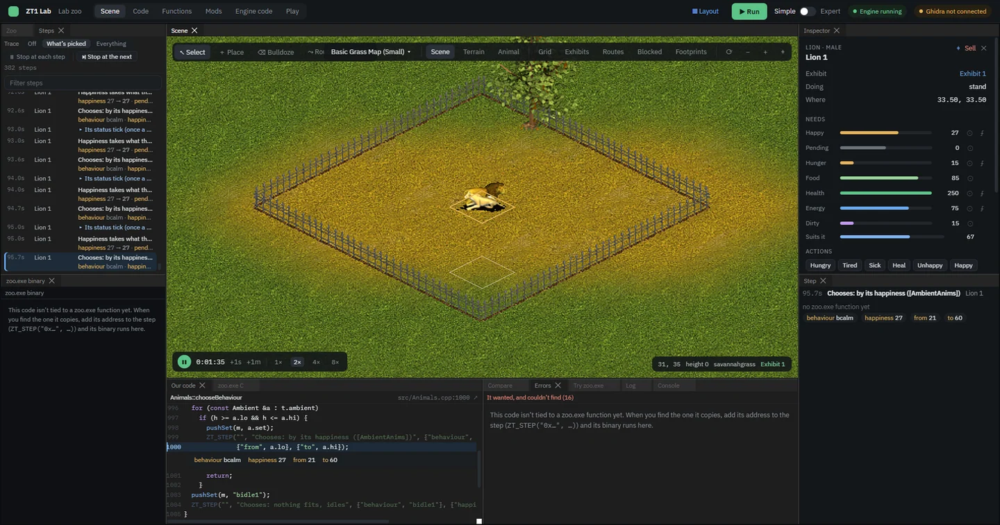

## Palette

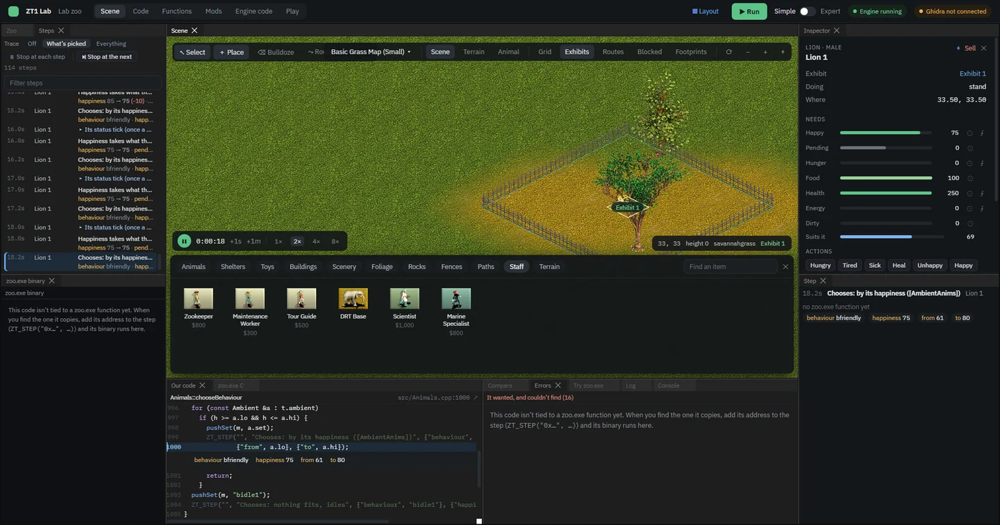

## Layout

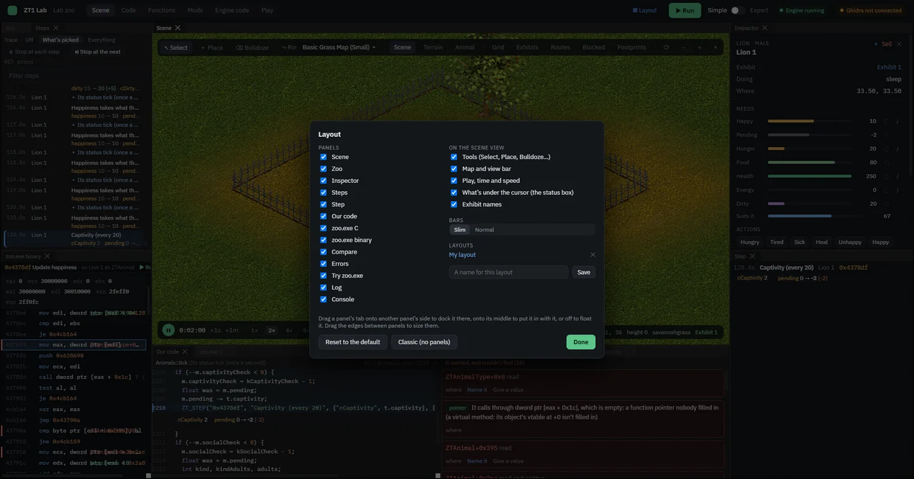

## Steps binary

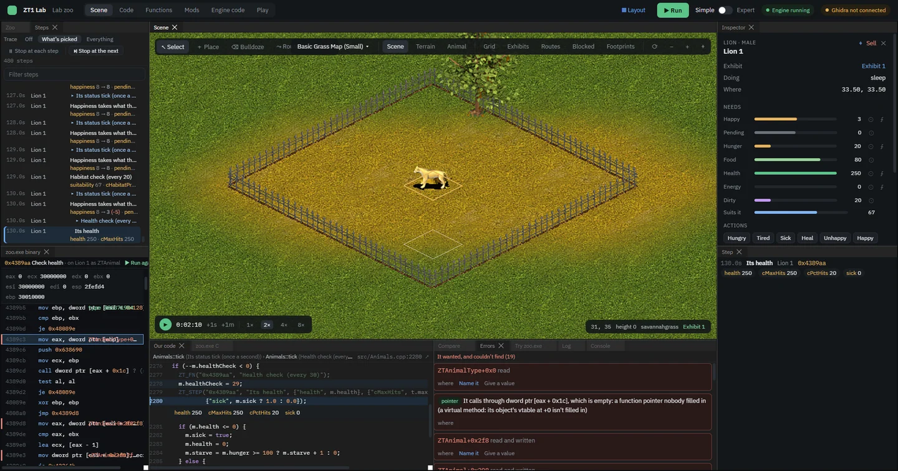

## Functions

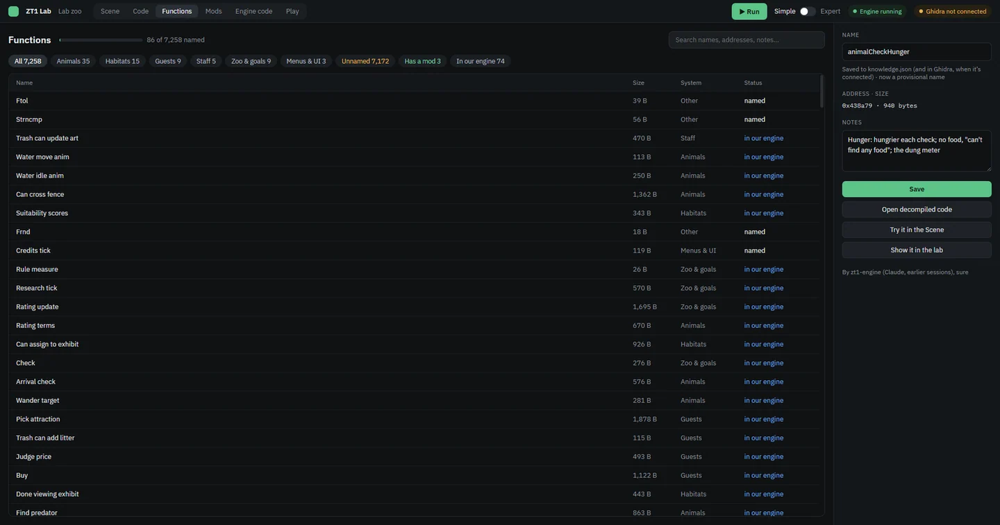

## Code

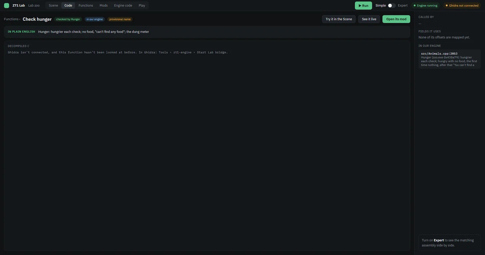

## Mods

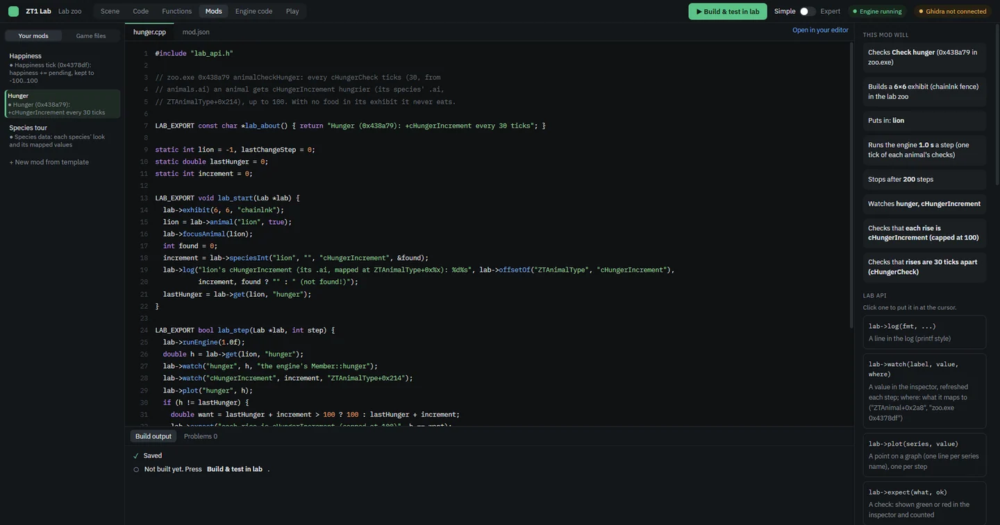

## Gamefiles reader

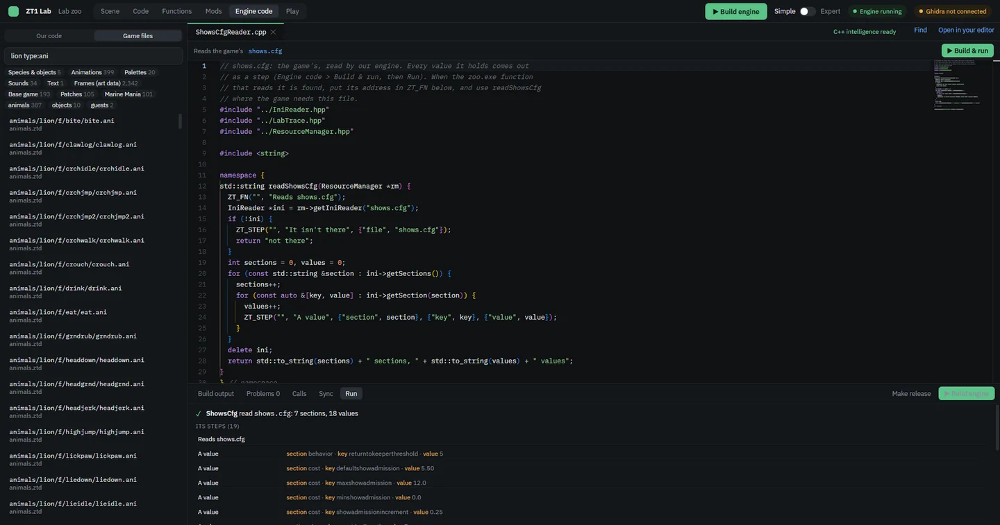

## Ani viewer

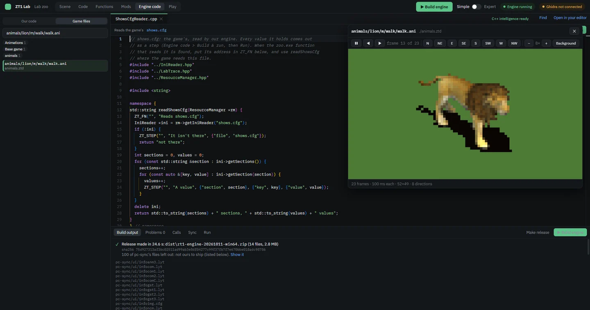

## Sync

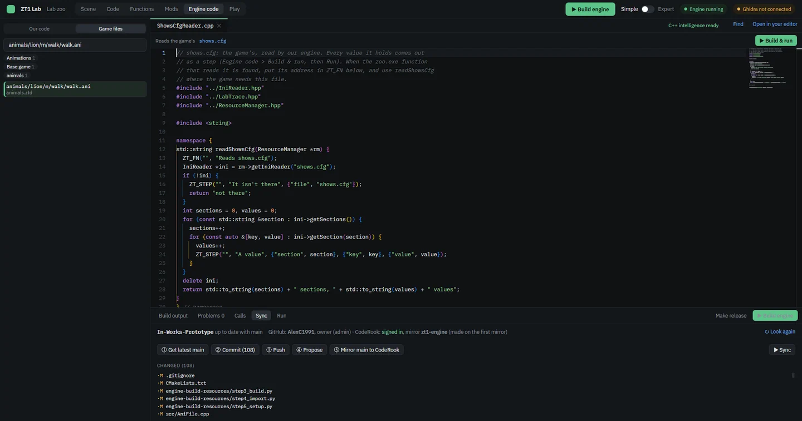

## Rightclick

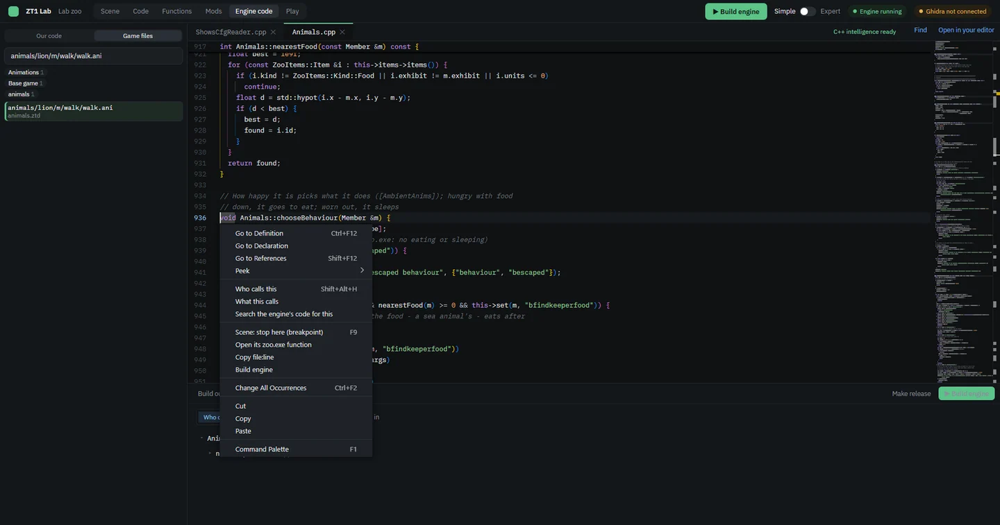

## Calls

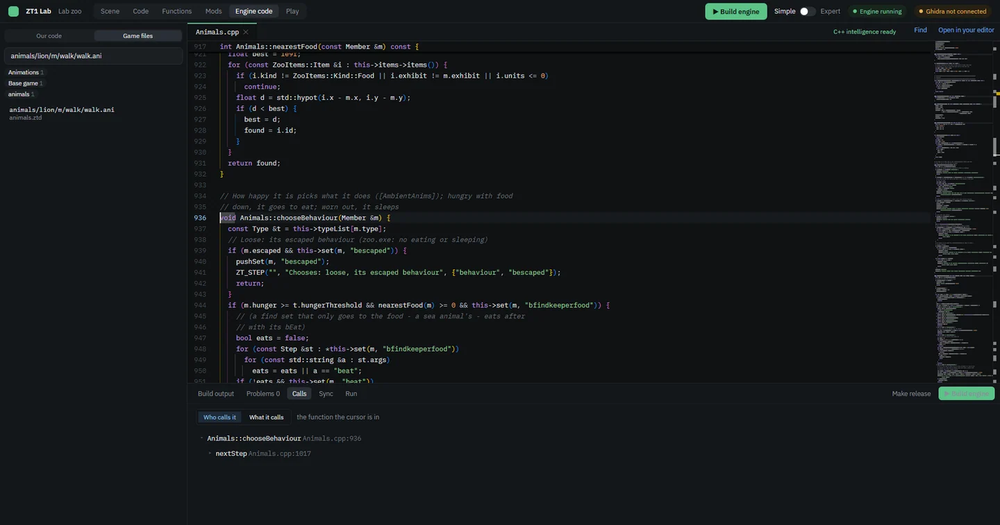

## Play

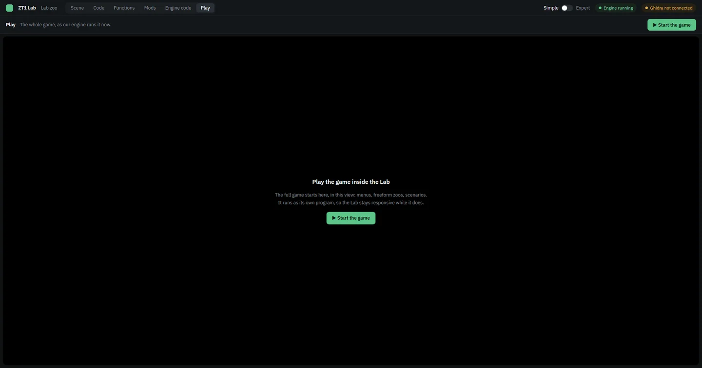

## Species check

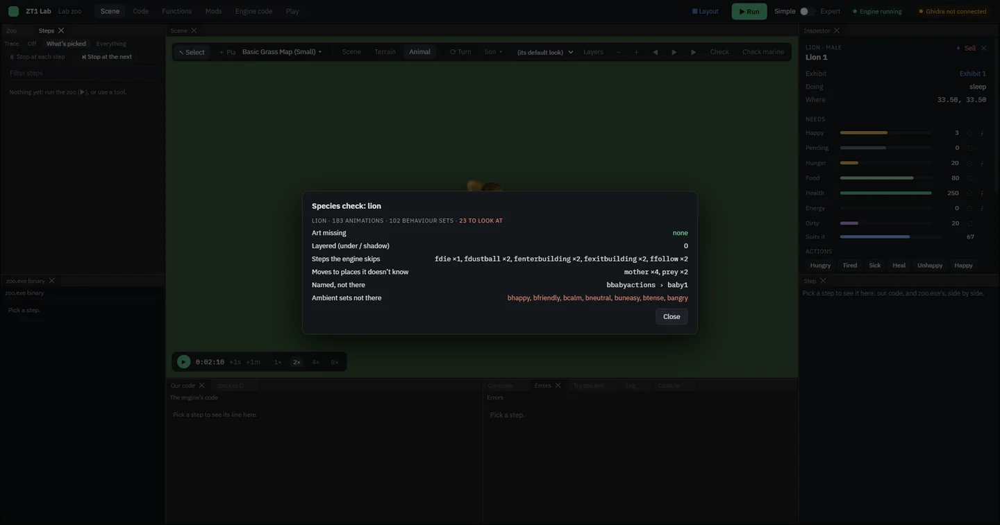

