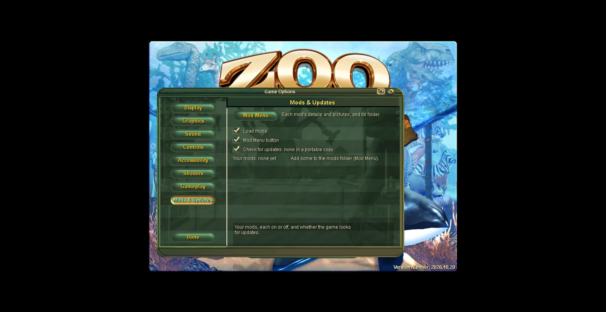
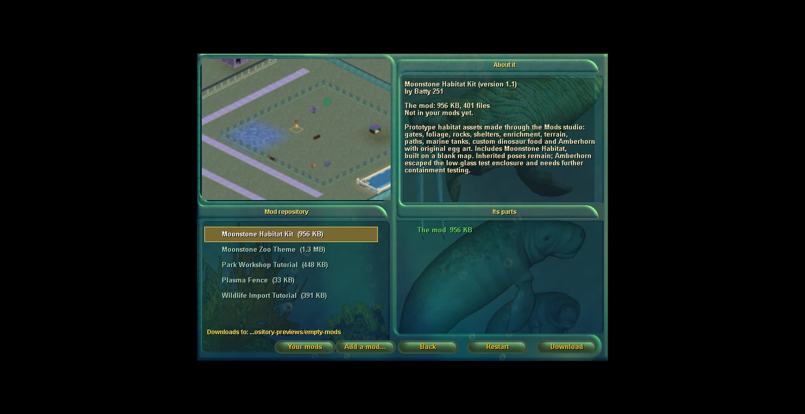
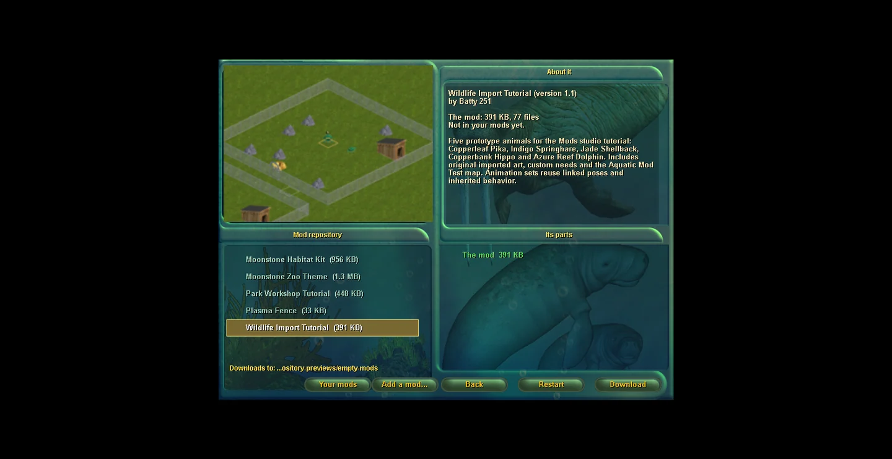
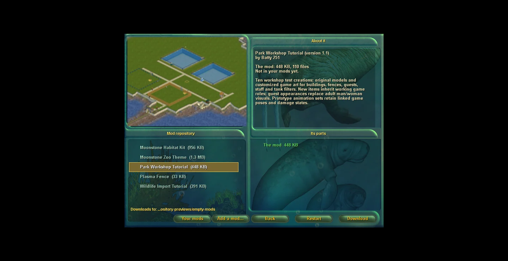
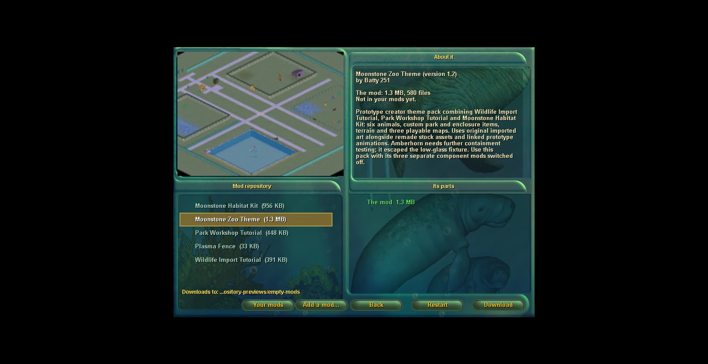
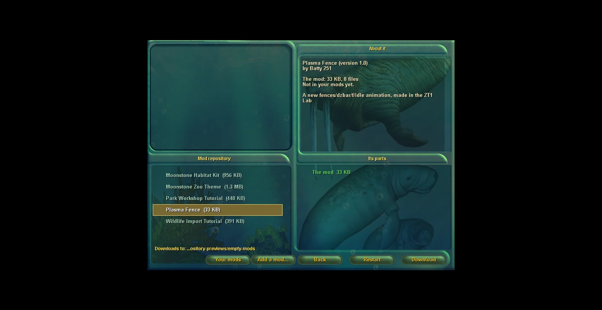
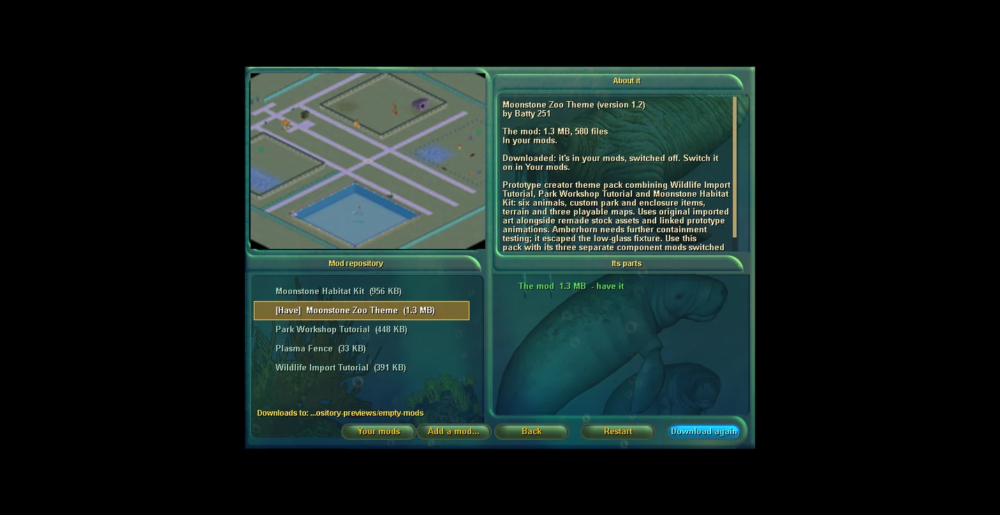
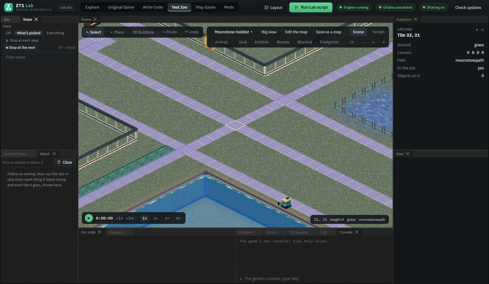

# Repository pictures: tutorial addendum

Recorded 26 October 2026. These are actual native-game checkpoints, presented as a captioned walkthrough; they are not a continuous screen recording.

1. In Lab **Mods**, select your mod or theme pack.
2. Set its cover under **About**, using your own image or **From the Test Zoo view**. Save edits and increase the version for an update.
3. Open **Publish**, run **Check it**, then **Upload it**. The current Lab prepares the repository thumbnail automatically. No separate picture upload is required.
4. Wait for the repository rules and malware scan to finish. A local check alone does not publish it.
5. In the actual game open **Game Options > Mods & Updates > Mod Menu > Mod repository**. Select the listing: its cover appears before installation.
6. Choose **Download**. After completion, open **Your mods**, switch it on and restart to load it. For a theme pack, keep its component mods off.

Older uploads need a version update through the current Lab to gain a repository thumbnail. A listing without a cover remains downloadable. This feature is in the current game build and the repository service; older installed game builds need the next engine release.

1. Start in the actual game with an empty mods folder. No installed copy can provide a cover.

2. Mod repository: Moonstone Habitat Kit 1.1 shows its cover before download.

3. Wildlife Import Tutorial 1.1: its own cover loads when the selection changes.

4. Park Workshop Tutorial 1.1: repository artwork is supplied by the approved upload.

5. Moonstone Zoo Theme 1.2: a theme pack has its own cover and one Download button.

6. Legacy listing without a thumbnail: the previous picture clears correctly.

7. Download finishes in the actual game. The theme is installed and switched off until enabled.

8. Testing finished: original mods settings restored, Play stopped and Test Zoo paused.

