# Publishing and downloading the new mods

26 October 2026. Actual Lab publish actions and native game downloads. The checkpoint video is a captioned sequence of real screenshots, not a continuous screen recording.

Published: Wildlife Import Tutorial 1.0, Park Workshop Tutorial 1.0, Moonstone Habitat Kit 1.0, Moonstone Zoo Theme 1.1. The theme contains all three components; keep the separate components off when using it.

Repository rule corrections: .zt1map map-design data and .cfg configuration data were added through the existing owner settings API. The program/script blocking and virus scan remain active. Before/after settings and rejected attempts are retained here.

Known gaps: repository browsing has no remote picture delivery; Your mods does display installed picture.png. Updating an enabled archive can fail on Windows until the game and Lab host unload it. Small downloads round to 0 MB in the current game UI. Amberhorn containment remains unresolved.

## 1. Publish in Lab: Wildlife Import Tutorial passes the server checks.

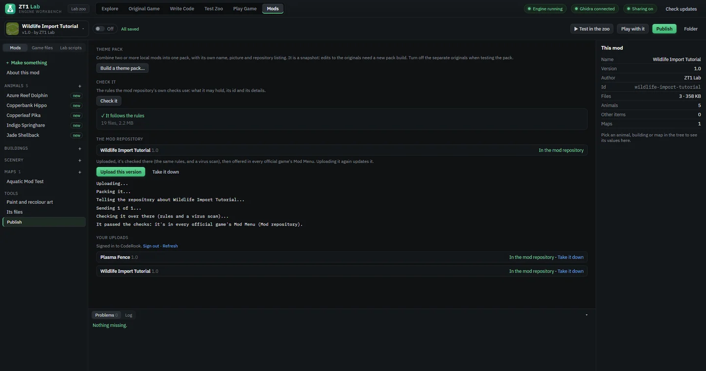

## 2. Publish the separate park mod. Server rules were corrected to accept game .cfg data.

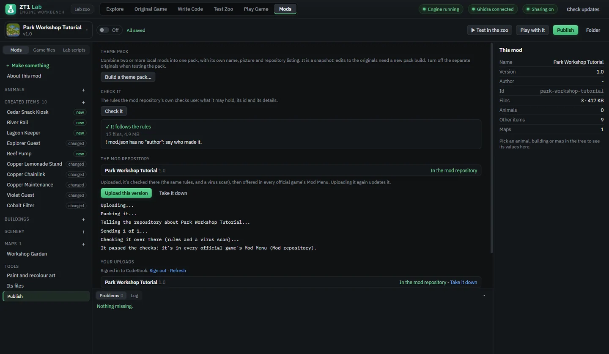

## 3. Actual game: Game Options > Mods & Updates > Mod Menu > Mod repository. Select the wildlife mod and Download.

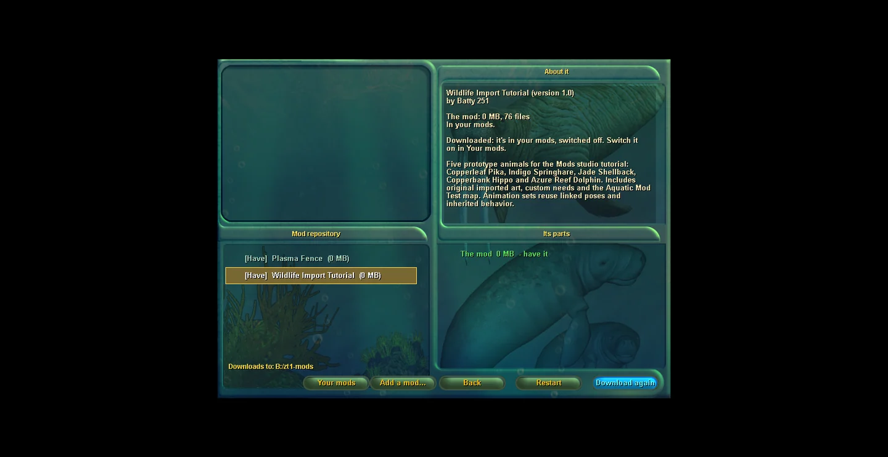

## 4. The habitat kit passes server rules and virus scanning. Its description retains the containment limitation.

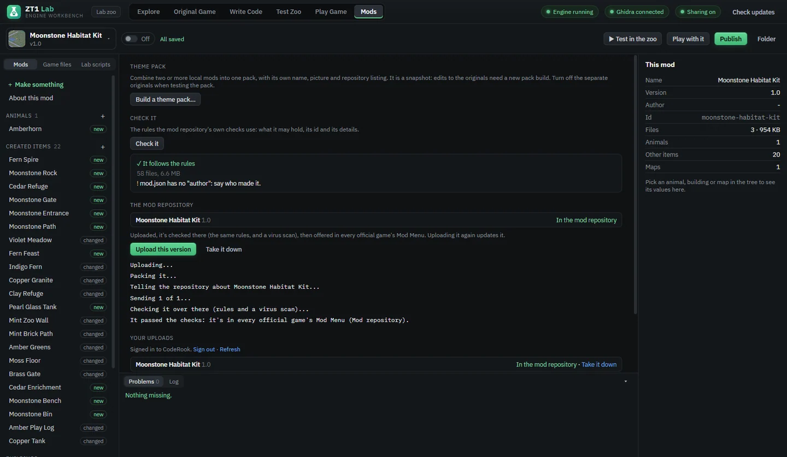

## 5. Download the park mod through the actual game. It appears as Have and starts switched off.

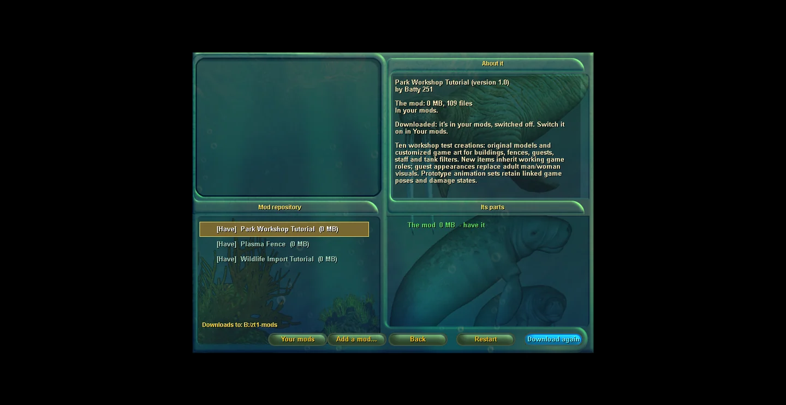

## 6. Your mods displays the downloaded picture correctly. Repository browsing still lacks remote image previews.

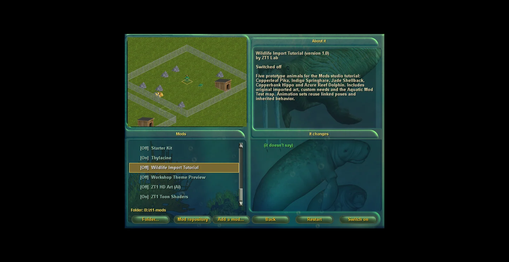

## 7. Download Moonstone Habitat Kit through the same player workflow.

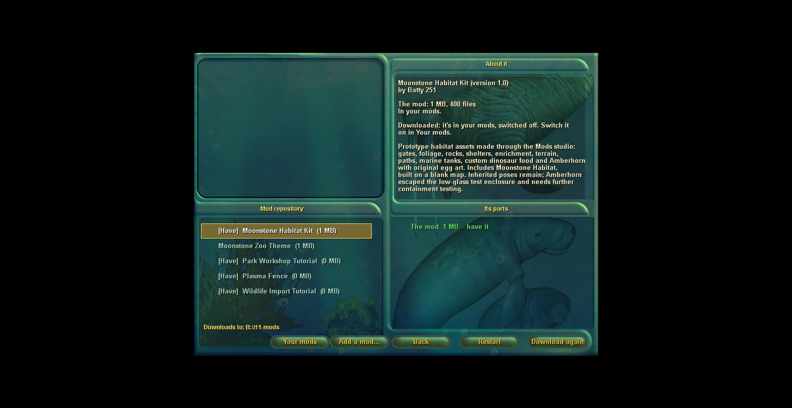

## 8. Retained failure: downloading over the enabled theme copy cannot unpack its locked archive.

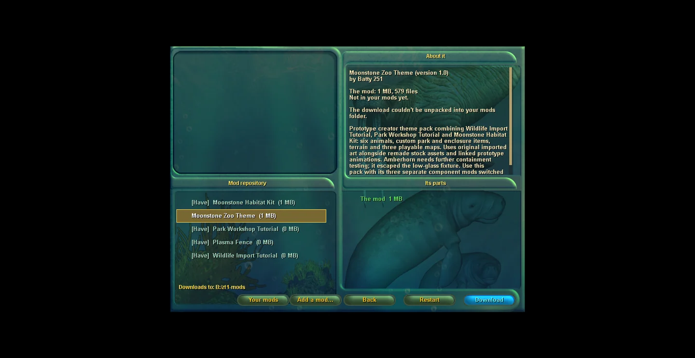

## 9. Switch the old pack off and restart both game and Lab host. Retry Download: the theme installs successfully.

## 10. Switch the downloaded theme on and restart Play. Its three custom maps appear in Freeform; Moonstone Habitat has its preview.

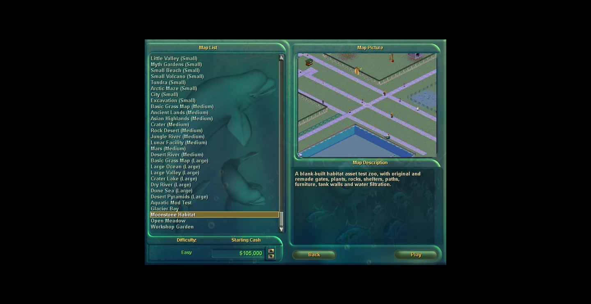

## 11. Moonstone Habitat opens with custom paths, gates, fences, shelters, park objects and marine tank.

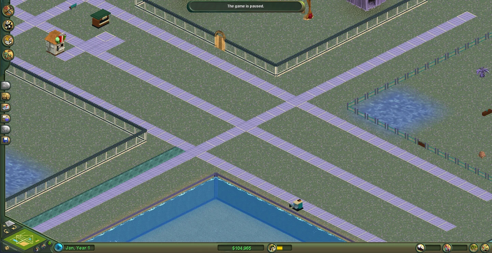

## 12. The Mods adoption filter exposes the downloaded custom animals.

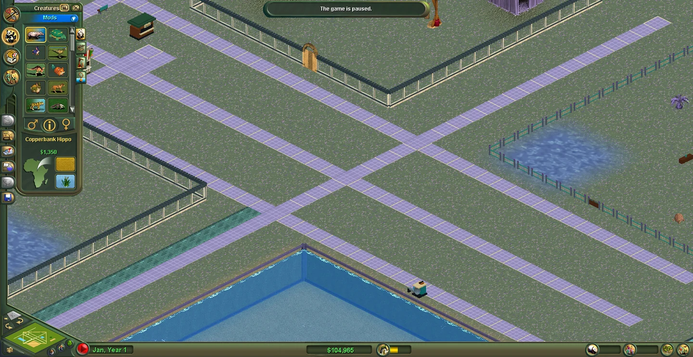

## 13. Adopt Amberhorn for $650: its original custom egg is placed. This is an installation smoke check, not a containment retest.

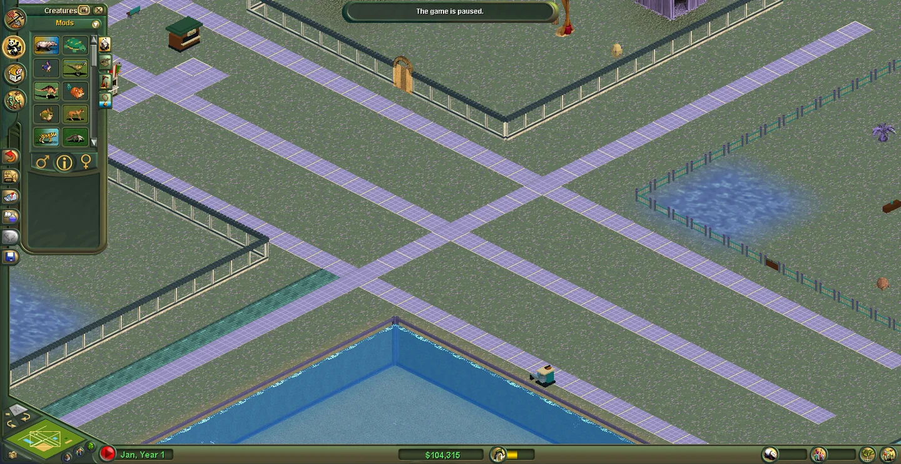

## 14. Adopt Azure Reef Dolphin for $1,450 inside the custom tank. Placement succeeds in the downloaded map.

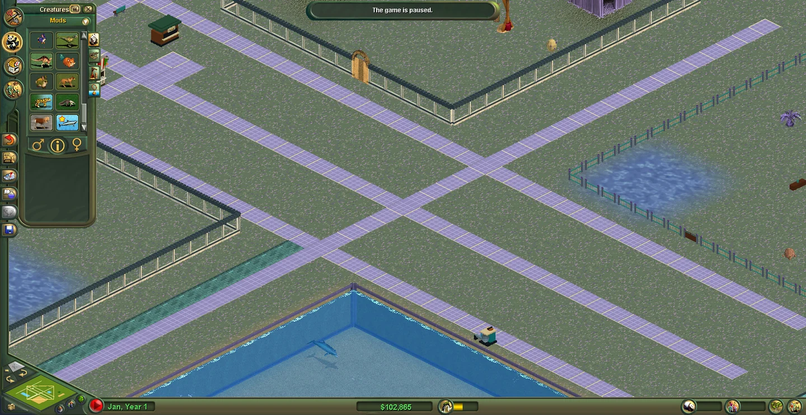

## 15. Replace the accidental terrain-texture cover through About > From the Test Zoo view. Theme version 1.1 changes its cover only.

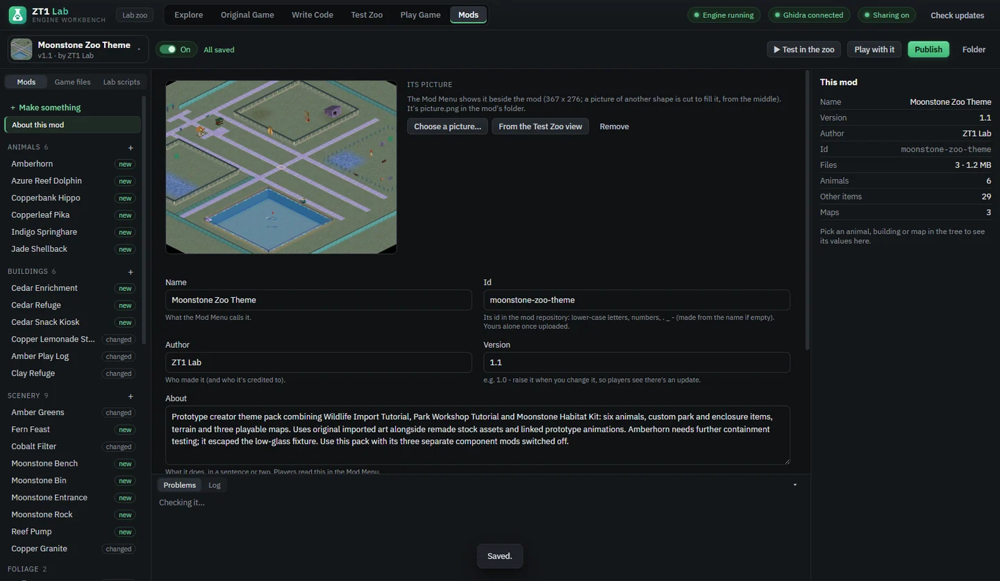

## 16. The actual game offers Update for version 1.1. Download it with the old archive unloaded; the repository confirms Have.

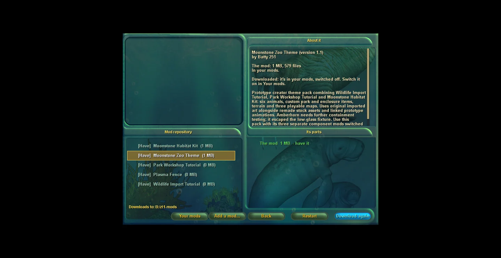

## 17. Your mods displays the corrected zoo-overview cover from downloaded version 1.1.

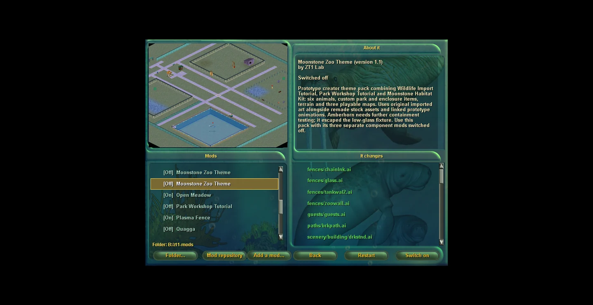

